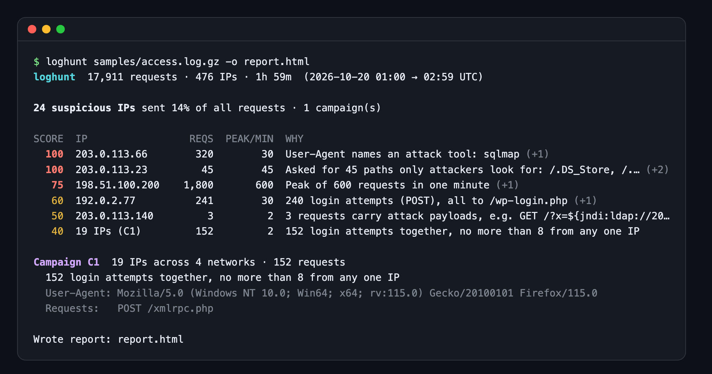
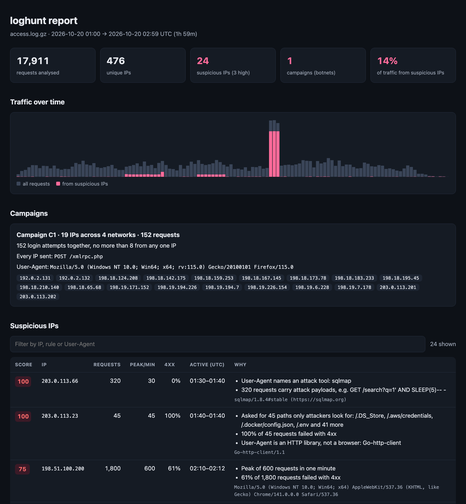

# loghunt

[](https://github.com/winxtxrgit/loghunt/actions/workflows/ci.yml)


[](LICENSE)

**Hunt bots, scanners and botnets in nginx/apache access logs. Every flagged IP comes with the reasons it was flagged.**

loghunt reads your access logs once and tells you who is attacking your site: SQL injection tools,
secret-file probers, login brute-forcers, floods, and the hard one, **botnets that spread a
brute-force across many IPs so each one stays under every threshold.**

<p align="center">
  
</p>

## Why

At a university hackathon I traced a 19-IP botnet through 1.4 GB of access logs (21 million
lines) with `awk`, `grep` and `sed`. loghunt turns that one-off investigation into a tool anyone
can run on their own server, with one principle: **rules decide, and every decision is
explained**, so you can check it before you block anyone.

## Try it in 10 seconds

```bash
pipx install git+https://github.com/winxtxrgit/loghunt
git clone https://github.com/winxtxrgit/loghunt && cd loghunt
loghunt samples/access.log.gz -o report.html
```

The sample is a synthetic two-hour log of a small site: 450 ordinary visitors, a search-engine
crawler and an uptime check, with six attackers hidden in it. loghunt finds all six and flags
nobody else (`tests/test_sample.py` checks exactly that).

## Usage

```bash
loghunt /var/log/nginx/access.log                     # summary in the terminal
loghunt access.log access.log.1 access.log.2.gz       # rotated logs, gzip detected by content
loghunt access.log -o report.html                     # single-file HTML report
loghunt access.log --blocklist block.txt              # suspicious IPs, one per line
loghunt access.log --json - | jq '.suspects[0]'       # machine-readable findings
zcat old/*.gz | loghunt -                             # read stdin
loghunt access.log --fail                             # exit 1 if anything is found (cron, CI)
loghunt access.log --min-score 70                     # only the worst offenders
```

Works with the nginx and apache **combined** format (the default on both) and the **common**
format. The common format has no User-Agent, so the two User-Agent rules and campaign grouping
are skipped there and everything else still runs.

## What it looks for

Each rule adds to an IP's score (capped at 100). IPs scoring **40 or more** are reported; one
weak signal alone is never enough.

| Rule | Score | Fires when |
| :--- | :---: | :--- |
| `scanner-agent` | 60 | The User-Agent names an attack tool: sqlmap, nikto, nuclei, wpscan, gobuster, masscan, … |
| `probe-paths` | 40–60 | 3+ different paths that only attackers ask for: `/.env`, `/.git/config`, `/phpmyadmin/`, `/actuator/env`, `backup.zip`, … |
| `attack-payload` | 50 | The URL carries SQL injection, path traversal, XSS, Log4Shell (`${jndi:`) or command injection (checked after URL-decoding) |
| `brute-force` | 45 | 20+ `POST`s to a login endpoint (`/wp-login.php`, `/xmlrpc.php`, `/login`, …) |
| `flood` / `burst` | 50 / 30 | 600+ / 120+ requests in a single minute |
| `error-ratio` | 25 | Half or more of 20+ requests ended in a 4xx |
| `script-agent` | 15 | No User-Agent, or an HTTP library (`python-requests`, `Go-http-client`, `curl`, …) |
| `campaign` | 40 | Member of a campaign (below) |

### Campaigns: catching low-and-slow botnets

Per-IP rules miss an attacker who rents 19 machines and sends eight login attempts from each.
loghunt fingerprints every IP by **the exact set of requests it made plus its User-Agent**. When
3 or more IPs share a fingerprint, and the group *added up* does something a single IP would be
flagged for (20+ login attempts, 3+ probe paths, any attack payload, mostly 4xx), the group
becomes a campaign and every member is flagged with the reason:

```
Campaign C1  19 IPs across 4 networks · 152 requests
  152 login attempts together, no more than 8 from any one IP
```

Ordinary visitors do not group this way. Two people who both open `/` and `/pricing` in the same
browser share a fingerprint, but the group does nothing suspicious, so it is not a campaign.

## The HTML report

One self-contained file you can attach to an incident ticket: summary, traffic timeline with the
suspicious share highlighted, campaigns with all their member IPs, and a filterable table of every
suspicious IP with its reasons. Light and dark themes follow your system.

<p align="center">
  
</p>

**Safe to open.** Everything in an access log is written by whoever sent the request, including
attackers. The report HTML-escapes every value that comes from the log and sets a
Content-Security-Policy of `default-src 'none'`, so it loads nothing from the network.
`tests/test_report.py` feeds it `<script>` tags in the URL and User-Agent to keep it that way.

## Speed

One pass over the log, no dependencies outside the Python standard library.

| Log | Lines | Time | Peak memory |
| :--- | ---: | ---: | ---: |
| `samples/access.log.gz` | 17,911 | 0.2 s | 23 MB |
| `generate.py --visitors 60000` (465 MB) | 2,108,396 | 10.7 s | 280 MB |

Measured on an Apple M2 with Python 3.12. Memory grows with the number of distinct IPs, not the
size of the log. To reproduce: `python samples/generate.py big.log --visitors 60000`.

## Before you block anyone

- Thresholds suit a typical small-to-medium site. A WordPress site sees real `POST
  /wp-login.php` traffic from its own users, so read the reasons before blocking.
- Several people behind one NAT or proxy share an IP. If your site sits behind a load balancer
  or CDN, log the real client IP (nginx `real_ip_header`, apache `mod_remoteip`), or every
  request will look like it came from the proxy.
- A User-Agent is whatever the client says it is. loghunt never trusts one to *clear* an IP,
  only to add a reason.

## Development

```bash
python -m venv .venv && . .venv/bin/activate
pip install -e ".[dev]"
pytest
ruff check . && ruff format --check .
python samples/generate.py samples/access.log.gz   # rebuild the sample (byte-identical)
```

Every IP in the sample comes from ranges reserved for documentation, benchmarking and carrier
NAT (RFC 5737, RFC 2544, RFC 6598), so no real address is labelled an attacker.

## License

[MIT](LICENSE) © Thanut Jongteerathanachote
